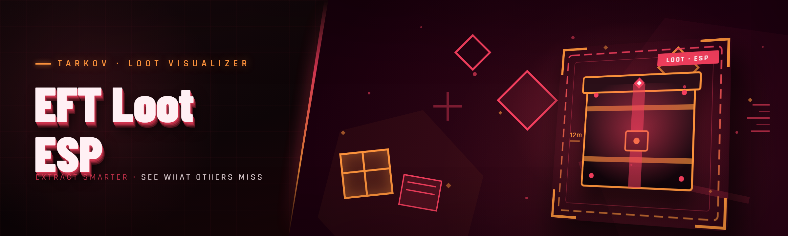

  
  
  

  

  
  
  

---

EFT Loot ESP — Tarkov loot radar with item ESP, container overlay, and distance readouts for high-value spawns.

## Overview

EFT Loot ESP — Tarkov loot radar with item ESP, container overlay, and distance readouts for high-value spawns.

  

## License

[MIT License](LICENSE)

  

